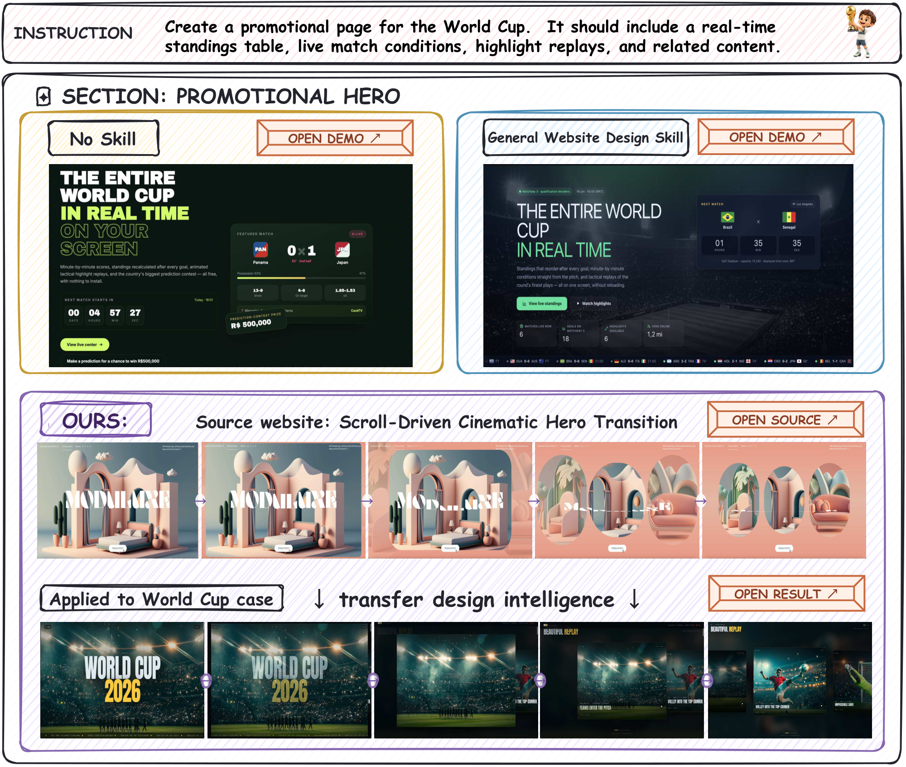
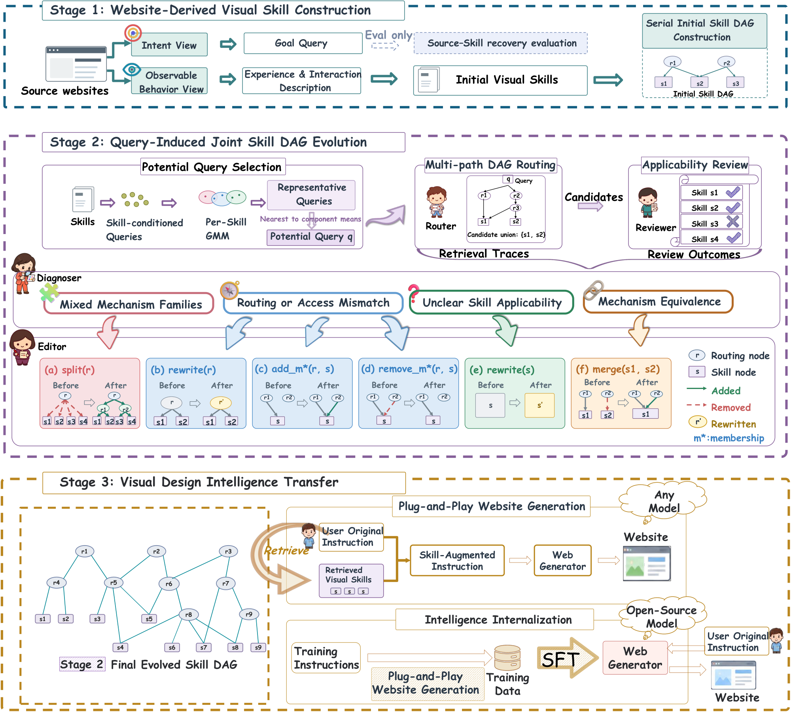
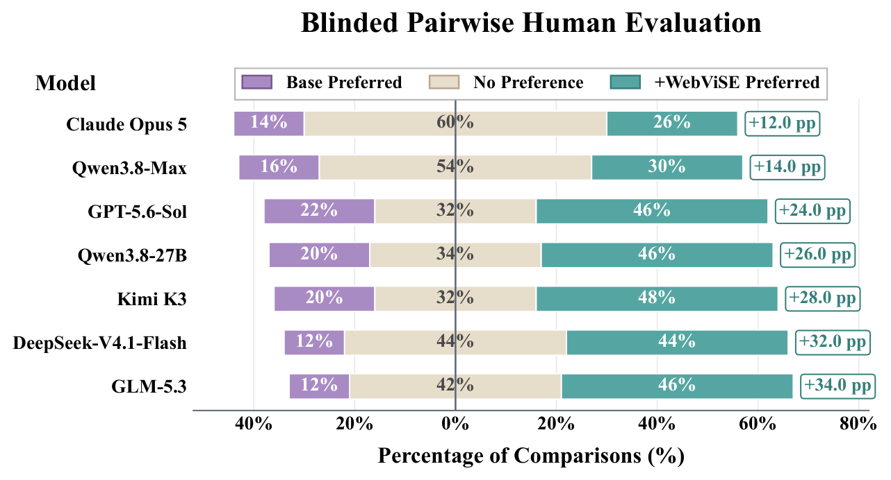

<div align="center">

# WebViSE

### Scaling Visual Design Intelligence from the Open Web for LLM Website Generation

**Turn implemented web experiences into reusable Visual Skills.**

<p>
  <a href="https://web-skill-dag.github.io/Web_SKill_DAG/showcase/"></a>
  <a href="./release_code/README.md"></a>
</p>

<table>
<tr>
<td align="center" width="33%"><a href="./initial_visual_skill_library/"><strong>Visual Skill Library</strong></a><br><sub>864 reusable Skills from implemented websites</sub><br><br><a href="./initial_visual_skill_library/"></a></td>
<td align="center" width="33%"><a href="./final_evolved_skill_dag/"><strong>Evolved Skill DAG</strong></a><br><sub>Structured access to complete Skill documents</sub><br><br><a href="./final_evolved_skill_dag/"></a></td>
<td align="center" width="33%"><a href="./release_code/README.md"><strong>Reproduce the Pipeline</strong></a><br><sub>Construction, joint evolution, and retrieval</sub><br><br><a href="./release_code/README.md"></a></td>
</tr>
</table>

### [▶ Explore the interactive website gallery](https://web-skill-dag.github.io/Web_SKill_DAG/showcase/)

Compare **No Skill**, **General Website Design Skill**, and **WebViSE** under the same instruction and generator.

[](https://web-skill-dag.github.io/Web_SKill_DAG/showcase/)

</div>

WebViSE extracts visual and interaction mechanisms from implemented websites, abstracts them into reusable **Visual Skills**, and organizes them in a **multi-parent Skill DAG**. Retrieved Skills give website generators concrete design knowledge for new instructions. Skill-guided teacher implementations can also transfer this knowledge into a generator through supervised fine-tuning.

> **Explore the interactive designs.** Open the [live gallery](https://web-skill-dag.github.io/Web_SKill_DAG/showcase/) to inspect the motion, controls, and interaction details in 16 controlled comparisons.

## At a glance

| Source websites | Initial Visual Skills | Root Categories | Qualitative comparisons |
| :---: | :---: | :---: | :---: |
| **850** | **864** | **11** | **16** |

The initial library contains **943 Category-to-Skill memberships**. A Skill may belong to several Categories because one mechanism can support several design roles.

## How WebViSE works



1. **Extract reusable visual mechanisms.** Complementary Intent and Observable Behavior Views connect a website’s purpose to its visible experience. Source-grounded construction recovers the implementation mechanism and writes a transferable `SKILL.md` document.
2. **Evolve the Skills and their retrieval structure together.** Skill-conditioned Potential Queries exercise the DAG through multi-path routing and full-document review. Diagnosis guides revisions to Skill descriptions, routing nodes, and memberships.
3. **Transfer the visual knowledge.** Use retrieved Skills as plug-and-play guidance, or synthesize Skill-guided teacher implementations and pair them with the original instructions for supervised fine-tuning.

The released code provides runnable workflows for **Visual Skill construction**, **joint Skill–DAG evolution**, and **plug-and-play instruction augmentation**. See the [release-code guide](./release_code/README.md) for each workflow’s configuration and input/output contracts.

## Quick start

### 1. Install the dependencies

Use Python **3.10 or later** in an isolated environment:

```bash
git clone https://github.com/guangnianyuji/WebViSE.git
cd WebViSE
python3 -m venv .venv
source .venv/bin/activate
python -m pip install -r release_code/requirements.txt
```

### 2. Retrieve Visual Skills for one instruction

Configure an OpenAI-compatible Chat Completions endpoint:

```bash
export BASE_URL="https://your-api.example.com/v1/chat/completions"
export API_KEY="your-api-key"
export MODEL="your-model"

bash release_code/play.sh --query "Create an interactive World Cup page with a cinematic hero, live standings, and highlight replays."
```

The command retrieves applicable Visual Skills from the released evolved DAG and prints an **augmented website instruction** to standard output. Pass that instruction to your website generator to build the page.

For the full construction and evolution workflows, fill in the provided `release_code/api_config.sh` and follow the [detailed setup instructions](./release_code/README.md).

## Explore the live comparisons

The qualitative gallery fixes the **original instruction and generator** within each case while varying the visual guidance.

| Experience | What to explore |
| --- | --- |
| [16-case website gallery](https://web-skill-dag.github.io/Web_SKill_DAG/showcase/) | Live three-way comparisons spanning promotional pages, dashboards, interactive editors, and 3D experiences. |
| [Plug-and-play case study](https://web-skill-dag.github.io/Web_SKill_DAG/case_study/) | The Guoqing Temple task, comparing the original instruction with retrieved Visual Skill guidance. |
| [Internalization case study](https://web-skill-dag.github.io/Web_SKill_DAG/internalization-case-study/) | Four conditions on the same Pointer Lab task: Base, +WebViSE, NoSkill-SFT, and WebViSE-SFT. |

<details>
<summary><strong>What is included in the 16-case gallery?</strong></summary>

World Cup Live Experience · Marketing Course Landing Page · Premium Auto Parts · Pattern Pinboard · Windows XP Desktop · Aquarium Dashboard · Wind Farm Monitor · Fitness Planner · Personal Finance Dashboard · Origami Instruction Studio · Bouncing Ball Physics · 3D Flame Simulation · Underwater Coral Reef · Intermittent Geyser · Rubik’s Cube · Interactive 3D Earth.

Each comparison reports the selected Visual Skills and lets you open the generated websites independently.

</details>

## Evaluation highlights

The paper evaluates generation on **WebGen-Bench**, **MiniAppBench**, and the **website subset of Cookie-Bench**, alongside blinded human comparisons and frozen Internal/External Skill-retrieval benchmarks.

- **Scalable retrieval:** with Qwen3.8-Max, the evolved DAG uses **39.09%** of Flat LLM’s estimated retrieval cost while improving the reported retrieval quality.
- **Transfer across generators:** Visual Skills can augment both closed-source and open-weight website generators.
- **Internalization:** Skill-guided training is compared with a matched NoSkill-SFT control using the same instruction collection and teacher.

<p align="center">
  
</p>

## Repository contents

| Path | Contents |
| --- | --- |
| [`release_code/`](./release_code/) | Runnable construction, evolution, and plug-and-play workflows; shared retrieval and model-facing prompts. |
| [`initial_visual_skill_library/`](./initial_visual_skill_library/) | The initial 864 unique Skills organized into 11 root Categories. |
| [`final_evolved_skill_dag/`](./final_evolved_skill_dag/) | The released recursive `graph.json` and full Skill documents in `skills.jsonl`. |
| [`showcase/`](./showcase/) | The 16-case interactive comparison gallery. |
| [`case_study/`](./case_study/) | The plug-and-play website-generation case study. |
| [`internalization-case-study/`](./internalization-case-study/) | Interactive websites for the four-way internalization comparison. |
| [`assets/`](./assets/) | Paper figures used in this README. |

The **released DAG snapshot** contains **163 nodes and 858 active Skills** after verified merges. These describe the released artifacts; they should be distinguished from the initial library and other evolution checkpoints.

## Contact

For questions about the release, open an issue or contact [guangnianyuji](https://github.com/guangnianyuji) at [2509090807@qq.com](mailto:2509090807@qq.com).

